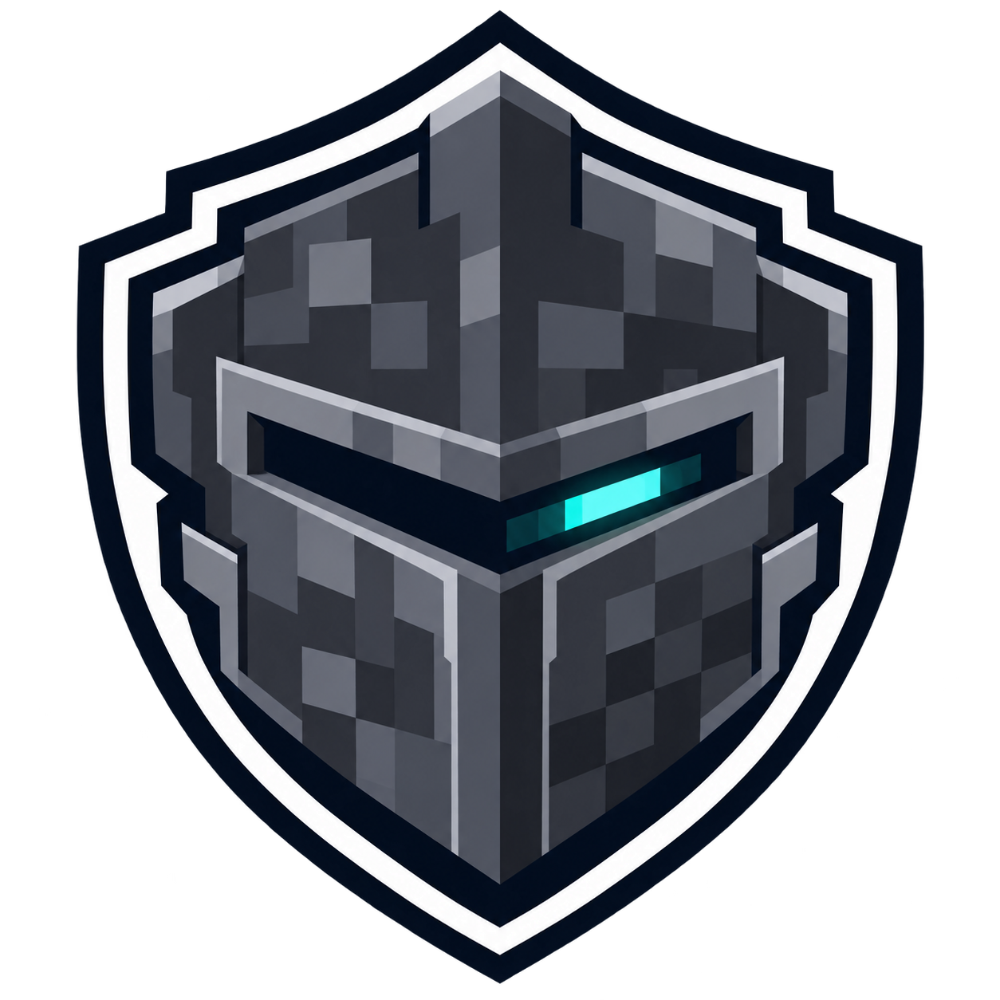

# BedrockGuard

Anti-cheat for **Bedrock players** on Java servers running Geyser/Floodgate.

Java anti-cheats (Grim, Vulcan…) are built around the Java client. Bedrock players arrive through Geyser with
different movement, touch controls and timing, so those anti-cheats either exempt them or flag them by mistake.
BedrockGuard analyses **only Floodgate players** and works alongside your existing Java anti-cheat.

> **Status:** version 1.0.0 released.

## Checks

| Check | Detects |
|---|---|
| Timer | Game running faster than real time |
| Speed | Horizontal movement above the vanilla limit (Speed effect and ice taken into account) |
| Fly | Vertical movement that ignores gravity, hovering in mid-air |
| Reach | Hits beyond 3 blocks, with ping compensation |
| Nuker | Several blocks broken in the same tick, or too many per second |
| Scaffold | Blocks placed in mid-air, several per tick, or too many per second |
| AutoClicker | Click rate above a human limit |
| BadPackets | Values no legitimate client can send |

Each check raises a violation level (VL) that decays over time. You get staff alerts in game, an optional Discord
webhook, and a configurable punishment command when a check reaches its maximum VL.

## Requirements

- Paper or Folia **1.21 → 26.x**, Java 21+ (tested on Paper 1.21.11, Paper 26.3 and Folia 26.3)
- [Floodgate](https://geysermc.org/download) and [PacketEvents](https://modrinth.com/plugin/packetevents) 2.14+
  installed as plugins
- Geyser on the server, or on a proxy: tested with **Velocity** 4.2 (modern forwarding) and **BungeeCord** build 2104
  (ip_forward), Geyser + Floodgate on the proxy and Floodgate on the game server
- Keep Geyser's `forward-player-ping` at its default `false`: with `true`, Paper kicks real Bedrock clients
  ("keepalive response without matching challenge"). With Geyser on the game server, BedrockGuard reads the real
  Bedrock ping through the Geyser API
- Timer and hover detection need **1.21.2+**: older versions don't send the end-of-tick packet they rely on

Alerts, commands and logs are available in English and French.

## Editions

- **Free**: every check, up to **5 Bedrock players** analysed at the same time, [available on SpigotMC](https://www.spigotmc.org/resources/bedrockguard-free.139718/)
- **Full**: no player limit, [available on Payhip](https://payhip.com/b/PlDW4)

## Documentation

- [Configuration](docs/configuration.md)
- [Commands and permissions](docs/commands.md)
- [Developer API](docs/api.md)

## Support

Report bugs and false positives in [Issues](../../issues). The source code of the anti-cheat is not public.

## Also by the author

[BedrockAssist](https://github.com/TheMax98000/BedrockAssist) (free): native Bedrock menus for what Geyser cannot translate
(links, commands, enchantments, anvil, villagers), [available on SpigotMC](https://www.spigotmc.org/resources/bedrockassist.139746/).
